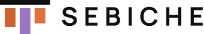

# Marca SEBICHE

<picture>
  <source media="(prefers-color-scheme: dark)" srcset="public/brand/sebiche-lockup-color.svg">
  
</picture>

SEBICHE es una familia de productos de tecnología para restaurantes independientes: **RestOS** (pedidos, POS, cocina y pagos), **TipTrack** (reparto, rutas, propinas y supervisión) y **86MISE** (inventario, compras y pronóstico). La identidad es oscura, editorial y cuadrada, como la cocina en servicio: tipografía grande con un acento serif en cursiva, hairlines en lugar de sombras y un color por producto.

Esta guía es la referencia en el repositorio. La guía visual completa y el design system viven en claude.ai (*SEBICHE Brand Guidelines* y *Sebiche*); si algo cambia aquí, sincronízalo allá.

## Fuente única: `brand/tokens.json`

Todos los valores de la marca están en [`brand/tokens.json`](brand/tokens.json), copia del design system (`soysebiche/sebiche-brand`, `design-system/project/tokens.json`): grupos de tokens `{ name, value, usage }` con alias `{surface}`. No lo edites aquí; cámbialo en el design system y cópialo. Lo que el design system no define (mapa de productos, geometría del símbolo, escala tipográfica fluida, escalas de peso, interlineado y tracking) está en [`brand/site.json`](brand/site.json), que referencia valores del design system con `{type.<estilo>.<prop>}`.

[`scripts/brand-tokens.mjs`](scripts/brand-tokens.mjs) resuelve los alias y aplana ambos archivos en `brand/tokens.flat.json` (generado), que es lo que leen el resto.

| Quién lo usa | Cómo |
| --- | --- |
| `brand/tokens.flat.json` | Generado: los tokens resueltos en forma plana (`color.ground`, `space.sm`…). |
| `app/tokens.css` | Generado: cada token como propiedad CSS en `:root`. |
| `app/holding.css`, `app/product.css` | Solo referencian `var(--…)`. |
| `tailwind.config.js` | Lee `brand/tokens.flat.json` y expone utilidades que apuntan a las variables (`bg-ground`, `text-label`, `tracking-wordmark`, `px-gutter`, `duration-fast`…). |
| `lib/og.tsx`, `app/manifest.ts`, `app/layout.tsx` | Importan `brand/tokens.flat.json`; las imágenes OG no leen variables CSS. |
| `components/brand/SebicheSymbol.tsx`, `lib/brand.ts` | Dibujan el símbolo desde su geometría (`brand/site.json`). |
| `public/brand/*.svg`, íconos y favicon | Generados. |

Para cambiar algo:

```bash
npm run brand
```

sincroniza `brand/tokens.json` o edita `brand/site.json` antes de correrlo. `npm run brand:check` falla si algún archivo generado quedó desactualizado; úsalo en CI. No edites a mano `brand/tokens.flat.json`, `app/tokens.css`, los SVG de `public/brand/`, `app/icon.svg`, `app/apple-icon.png` ni `app/favicon.ico`.

Las únicas cifras literales que quedan en los CSS son medidas de layout de un componente (anchos máximos, alturas mínimas de una sección, columnas de la retícula).

## Logo

### El símbolo: *El pase*

<picture>
  <source media="(prefers-color-scheme: dark)" srcset="public/brand/sebiche-pase-color.svg">
  
</picture>

El pase es el riel de la cocina donde se cuelgan las comandas. El símbolo es ese riel con tres comandas, una por producto, de izquierda a derecha: `copper` (RestOS), `violet` (TipTrack) y `orange` (86MISE). Cada comanda tiene un largo distinto, como pedidos en distintos momentos del servicio.

- Construcción en un cuadrado de 100 unidades: riel de 84 × 8 en y 22; comandas de 18 de ancho con 7 de separación, desde y 36, de 32, 44 y 26 de alto. Solo esquinas rectas.
- **Zona de seguridad:** el ancho de una comanda (18% del símbolo) por cada lado.
- **Tamaño mínimo:** 24px a color, 16px a una tinta; el lockup, 120px de ancho. A 16px el favicon usa una versión a una tinta ajustada a píxeles.
- El símbolo solo, sin wordmark, va donde el nombre no cabe: favicon, ícono de app, avatar, sello.

### Wordmark y lockups

El wordmark es `SEBICHE` en Manrope Bold, siempre en mayúsculas, con tracking de 0.22em. En los archivos está convertido a trazos, así que no depende de la fuente instalada.

En el **lockup horizontal**, el símbolo mide 2.3 veces el cuerpo del wordmark y queda a un ancho de comanda de él. Es la firma por defecto: encabezado, documentos, firma de correo. El **lockup apilado** pone el wordmark centrado bajo el símbolo, con el ancho de 1.5 rieles. Se usa en formatos cuadrados: avatar con nombre, portada, merch.

### Archivos (`public/brand/`)

| Archivo | Uso |
| --- | --- |
| `sebiche-pase-color.svg` | Símbolo sobre fondos oscuros (por defecto). |
| `sebiche-pase-color-light.svg` | Símbolo sobre fondos claros e impresión en papel: riel en `on-accent`. |
| `sebiche-pase-paper.svg` | Una tinta clara: sobre oscuros y fotos con velo, y por debajo de 24px. |
| `sebiche-pase-ink.svg` | Una tinta oscura: sobre `copper`, `violet`, `orange` o fondos claros. |
| `sebiche-pase-current.svg` | Una tinta en `currentColor`, para SVG en línea que heredan el color del texto. |
| `sebiche-wordmark-{paper,ink,current}.svg` | Wordmark solo. |
| `sebiche-lockup-{color,color-light,paper,ink}.svg` | Lockup horizontal. |
| `sebiche-lockup-stacked-{color,color-light,paper,ink}.svg` | Lockup apilado. |
| `{restos,tiptrack,86mise}-by-sebiche.svg` | Firma de producto sobre fondos oscuros. |
| `{restos,tiptrack,86mise}-by-sebiche-ink.svg` | Firma de producto a una tinta, sobre su color o fondos claros. |
| `icon-192.png`, `icon-512.png`, `icon-maskable-512.png` | Íconos del manifiesto (el maskable deja el símbolo al 72% para la zona segura). |

Sobre un relleno de acento usa solo las versiones `ink`. Sobre fotos, solo con el velo oscuro encima.

### Productos: arquitectura respaldada

<picture>
  <source media="(prefers-color-scheme: dark)" srcset="public/brand/tiptrack-by-sebiche.svg">
  
</picture>

Cada producto se firma con su nombre en su color (Manrope Medium, tracking −0.055em) seguido de `by SEBICHE`. Los nombres son exactos: `RestOS`, `TipTrack` y `86MISE`. Nunca pongas el símbolo junto al nombre de un producto como si fuera su logo.

### Usos incorrectos

No reordenes los colores de las comandas ni cambies sus alturas. No redondees esquinas, no rotes, no contornees y no agregues sombras ni degradados. No recolorees el wordmark con el color de un producto, no lo compongas en otra fuente y no lo escribas en minúsculas. No pongas el símbolo sobre una foto sin velo.

## Color

La marca es solo oscura. No hay modo claro en el sitio: las versiones `-color-light` e `ink` existen para impresión y para fondos ajenos (documentos, socios, merch).

| Token | Valor | Uso |
| --- | --- | --- |
| `ground` | `#090909` | Fondo de todo. |
| `surface` · `-panel` · `-deep` · `-frame` | `#10100f` · `#11110f` · `#0d0d0c` · `#161716` | Tarjetas, formulario y pantallas, bloque 86, marcos de capturas. Casi imperceptibles a propósito. |
| `paper` | `#f1eee7` | Texto principal y wordmark (17:1). |
| `muted` | `#9e9a92` | Texto secundario (7.1:1). |
| `soft` | `#d3cfc8` | Descripción dentro de una tarjeta. |
| `rule` | `paper` al 22% | Hairlines de 1px entre secciones y celdas. |
| `copper` | `#cf6330` | Acento de la marca y de RestOS (5.2:1). |
| `copper-action` / `-hover` | `#a94721` / `#933e1d` | Botón principal; texto `on-action` blanco (5.8:1). |
| `violet` | `#9a76c5` | TipTrack (5.5:1). |
| `orange` | `#dd713d` | 86MISE. |
| `olive` | `#9ca66a` | Solo la tercera marca de los pilares. No es color de producto ni de interfaz. |
| `on-accent` | `#100f0e` | Texto sobre `copper`, `violet` u `orange`, nunca blanco. |
| `focus` | `#bd5727` | Contorno de foco de 2px, separado 3px. |

Cada página de producto fija `--accent` a su color (`--product-restos`, `--product-tiptrack`, `--product-86mise`) y no usa los de los otros productos.

## Tipografía

**Manrope** para todo. **Cormorant Garamond** en cursiva solo como acento: la palabra clave dentro de un titular, los numerales (`86`, la cifra de prueba) y el pie editorial. La familia `mono` solo aparece en el ticket de pedido.

Escala (`--text-*`). Los tamaños de display son fluidos:

| Token | Tamaño | Uso |
| --- | --- | --- |
| `micro` | 0.54rem | Descriptor del lockup, ticket. |
| `label` | 0.72rem | Etiquetas en mayúsculas, bold, tracking `label` (0.08em). |
| `xs` | 0.78rem | Navegación, pie, datos de contacto. |
| `sm` | 0.86rem | Botones, descripciones de tarjeta, listas. |
| `base` | 0.95rem | Texto corrido. |
| `lead` | 1 → 1.25rem | Párrafo de introducción. |
| `caption` | 1.2rem | Pie editorial en cursiva. |
| `glyph` | 1.7rem | Glifos de los pilares (`↓`, `≋`, `▥`). |
| `step` | 1.2 → 1.75rem | Títulos de pasos, capacidades y pilares. |
| `title` | 1.8 → 3rem | Nombre de producto en su tarjeta, titulares de sección secundarios. |
| `display-m` | 2.5 → 5rem | Titulares de bloque. |
| `display-l` | 3 → 6rem | Titulares de sección. |
| `display-xl` | 3.5 → 7rem | H1 de cada página. |
| `display-2xl` | 3.5 → 8rem | Llamado final. |
| `display-sm` / `display-sm-hero` | 3.4rem / 3.4 → 5rem | Titulares e H1 en móvil. |
| `numeral-proof` / `numeral-86` | hasta 10rem / 15rem | Numerales editoriales; uno por página. |

Los titulares van en peso `display` (450), con interlineado `display` (0.9) y tracking muy negativo (`display`, −0.06em, o `display-tight`, −0.065em). Se parten en líneas y una palabra clave va en `<em>` editorial: *Tu restaurante, **conectado** de punta a punta.* Los titulares van en tipo oración y las etiquetas en mayúsculas.

## Espacio, forma y movimiento

- **Espaciado** (`--space-*`): `3xs` 0.375 · `2xs` 0.5 · `xs` 0.75 · `sm` 1 · `md` 1.5 · `lg` 2 · `xl` 3 · `2xl` 4 · `3xl` 6rem. El margen de página es `gutter` (3.5vw) y `gutter-sm` (1.25rem) bajo 680px. El ritmo vertical de las secciones es `section` (5 → 9rem) o `section-sm` (3 → 6rem); el relleno de celdas y tarjetas, `cell`.
- **Medidas:** controles táctiles de `control-min` (2.75rem) como mínimo, botón de `button-height` (3.65rem), encabezado de `header-height` (6.7rem; 5.5rem bajo 980px).
- **Forma:** `radius-none` en todo, sin una sola esquina redondeada. La jerarquía se marca con hairlines de 1px, no con sombras. La única sombra es `shadow-ticket`, la del ticket sobre la foto del hero.
- **Movimiento:** `duration-fast` (180ms, `ease-standard`) para hover. El botón sube `lift-button` (2px), las tarjetas `lift-card` (0.25rem) y el subrayado de la navegación crece desde la izquierda. `duration-slow` (500ms) es el zoom de imágenes en tarjetas. `duration-entrance` (1.1s, `ease-out`) es la entrada de la foto del hero. Con `prefers-reduced-motion` no hay animación ni scroll suave.

## Fotografía

Cocina real en servicio: el pase, la línea, manos trabajando. Nunca stock genérico ni imágenes generadas.

- Hero: `photo-hero`, es decir `saturate(0.65) contrast(1.1) brightness(0.72)`, bajo `veil-hero`. La imagen OG usa el mismo tratamiento.
- Operaciones: `photo-mono`, `grayscale(1) contrast(1.18) brightness(0.72)`.
- Cierre: la foto bajo `veil-closing`, del 78% al 42%.
- Capturas de producto: en un marco de 1px `rule` sobre `surface-frame`, recortadas desde arriba.

## Iconografía

No hay set de íconos. Las marcas son glifos tipográficos en un cuadrado con borde de 1px en `currentColor`: `OS` (RestOS), `↗` (TipTrack), `▤` (86MISE). Los pilares usan `↓`, `≋` y `▥` en `copper`, `violet` y `olive`. Sin emoji.

## Voz

- Segunda persona, directa: "Tu restaurante, conectado de punta a punta." / "Your restaurant, connected end to end."
- Bilingüe, español e inglés, pero un solo idioma por pieza.
- Se habla desde la operación, no desde la tecnología: "Menos fricción", "Más control", "Decisiones con contexto". Sin jerga de software frente al cliente.
- Se dice el estado real de cada producto. Nunca se prometen funciones que no existen.
- Los términos de cocina se usan cuando aportan: *86* (agotado), *mise en place*, *el pase*, *la línea*.
- La marca es SEBICHE: no se citan personas ni empresas anteriores como prueba de autoridad.
